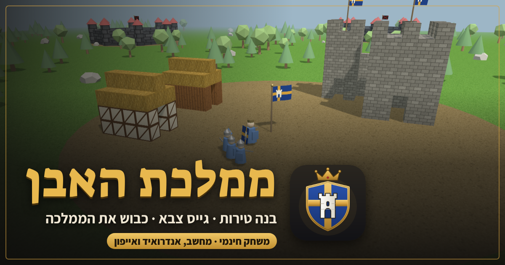

# ממלכת האבן

משחק סנדבוקס מימי הביניים בתלת־ממד: בונים טירות, מגייסים צבא, כובשים מבצרי אויב ומעצבים דגל וממלכה.

**לשחק:** https://liors24.github.io/stone-kingdom/

עובד בדפדפן במחשב, באנדרואיד ובאייפון. כדי לשחק במסך מלא בטלפון: שתף ← "הוספה למסך הבית".

## מה חדש בגרסה 4

- דמויות אנושיות עם שלד: פנים, ידיים, ברכיים ומרפקים שמתכופפים, ושריון ובגדים לפי כל אימפריה.
- המלך נראה שונה מהאבירים ומהתושבים: גלימה מלכותית, כתר ושרביט.
- כלי נשק מציאותיים: חרבות עם להב ומשמר, קטאנה, טלוואר, חפש, גרזנים, חניתות וקשתות.
- רכיבה לבחירה: סוס, סוס מלחמה, גמל, פיל, סוס ערבות או אייל צפון, לפי האימפריה.
- מצב גוף ראשון: שליטה במלך או באביר.
- תאורת פנטזיה בלילה: פנסים, חלונות מאירים, ניצוצות קסומים וזוהר צפוני.

מקשים במחשב: R לרכיבה, V לגוף ראשון, C להחלפת לוחם, רווח או לחיצה לתקיפה.

## מה חדש בגרסה 5

- ארמון מלוכה גדול עם ארבעה צריחים, אכסדרה ודגלים, וכלי בנייה חדש להקמת ארמון.
- אירועים בממלכה: מגפה, שריפה, גנבים, מחאה, רעב, בצורת, פליטים וסוחר נודד. בוחרים איך לפתור אותם, וזה משפיע על שביעות רצון העם ועל המסים.
- החלפת נשק במקשים 1, 2, 3: חרב, ידיים חשופות וקשת. F עובר לגוף ראשון.
- לוחמים פצועים הולכים לבד למרפאה.
- כפתור "הגנו על הארמון", חץ אדום שמראה מאיפה הפשיטה מגיעה, והתרעה על ניסיון פריצה בחומה.
- מגדלי שמירה עם קשתים שיורים בפושטים.

## מה חדש בגרסה 6

- תפריט ראשי: המשך משחק, ממלכה חדשה עם בחירת אימפריה, ואיפוס האימפריה הנוכחית.
- עולם אינסופי: אפשר ללכת לכל כיוון, והקרקע, האקלים, העצים והאוצרות נוצרים תוך כדי הליכה.
- אויבים שלא נגמרים: מבצרי פרא חדשים בכל אזור, חזקים יותר ככל שמתרחקים, להקות שודדים שצדות את המלך, ופשיטות שמתחזקות עם הזמן.
